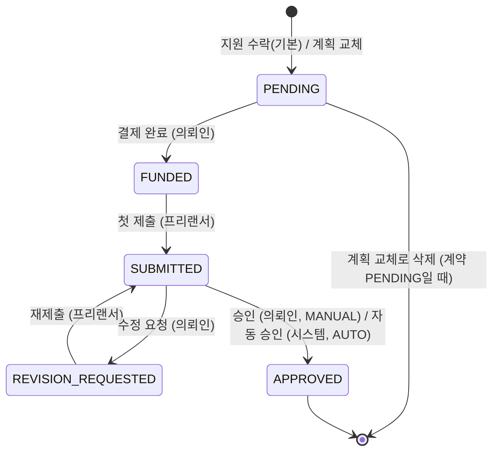
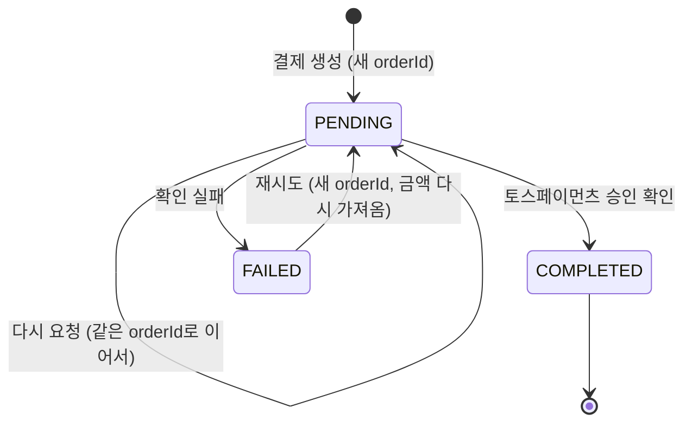
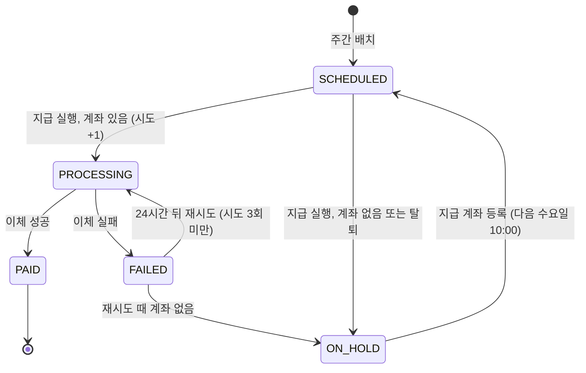

# 마일스톤, 안전결제, 정산

계약 금액은 마일스톤으로 나뉘고, 의뢰인은 마일스톤마다 대금을 먼저 결제한다(안전결제). 프리랜서가 결과물을
제출하고 의뢰인이 승인하면(기한 안에 판단이 없으면 자동 승인) 그 금액이 수수료를 뺀 정산 항목이 되고, 매주 한 번
묶여 프리랜서의 지급 계좌로 나간다.

## 돈 규칙

모든 금액은 **원 단위 정수**이고 계산은 basis point 정수 연산이다. 수수료·부가세·반올림은 `src/lib/money.ts`만
거친다. DB 금액 컬럼이 `Float`인 것은 알고 있는 부채이고([DATABASE.md](../DATABASE.md#금액이-float인-부채)), 새로
쓰는 값은 항상 정수다. 정수가 아닌 금액 입력은 거절한다.

| 규칙 | 값 | 기준 |
| --- | --- | --- |
| 플랫폼 수수료 | 승인된 마일스톤 금액의 10%, **프리랜서 부담**. 의뢰인은 마일스톤 금액만 낸다 | `PLATFORM_FEE_RATE_BPS = 1000` |
| 수수료 부가세 | 수수료의 10%, 프리랜서 부담 | `FEE_VAT_RATE_BPS = 1000` |
| 계산 순서 | `fee = floor(gross × 10%)` → `vat = floor(fee × 10%)` → `net = gross − fee − vat`. 원 미만은 **버린다** | `payoutBreakdown()` |
| 요율 스냅샷 | 정산 항목은 승인 시점의 요율을 저장한다. 요율이 바뀌어도 이미 만든 항목은 그대로다 | `SettlementItem.feeRateBps` |
| 정산 합계 | 항목에 저장된 값의 합. 합계 금액에서 다시 계산하지 않는다 | `sumBreakdowns()` |
| 계약 금액(원) | 계약 금액을 반올림(0.5는 올림)한 값. 기본 마일스톤, 계획 합계, 서명 검사가 모두 이 값을 쓴다 | `wholeWon()` |
| 최소 지급액 | 없다 | |

| 금액(gross) | 수수료 | 부가세 | 지급액(net) |
| --- | --- | --- | --- |
| 1,234,567 | 123,456 | 12,345 | 1,098,766 |
| 10,000 | 1,000 | 100 | 8,900 |
| 15,005 | 1,500 | 150 | 13,355 |
| 15,005 두 건을 묶은 정산 | 3,000 | 300 | 26,710 |

마지막 줄을 합계 30,010에서 다시 계산하면 수수료가 3,001이 된다. 정산은 항목의 합인 3,000을 보고한다. 프리랜서가
건별로 본 금액과 정산서의 금액이 항상 맞아야 하기 때문이다.

## 마일스톤 계획

계약이 `PENDING`(서명 전)인 동안 의뢰인이 계획 전체를 바꿀 수 있다. 배열 순서가 순번(1..n)이 된다. 계획을 바꾸면
양측 서명이 초기화된다([projects-contracts.md](projects-contracts.md#서명과-계획-교체)).

| 정책 | 값 | 기준 |
| --- | --- | --- |
| 마일스톤 수 | 계약당 1~10 | `MIN_MILESTONES`, `MAX_MILESTONES` |
| 최소 금액 | 10,000원. 수락 때 생기는 기본 마일스톤은 예외(그래서 1만 원 미만 계약은 기본 마일스톤을 유지한다) | `MIN_MILESTONE_AMOUNT` |
| 금액 합계 | 계약 금액(원)과 정확히 같다 | |
| 기한 | 날짜(`YYYY-MM-DD`, KST). 오늘은 되고 과거는 안 된다. 순번이 커질수록 줄어들 수 없다(같은 날은 된다). 그날 23:59:59.999 KST로 저장 | `kstDateToEndOfDay()` |
| 제목 / 설명 | 1~100자 / 2,000자 이하 | `src/schemas/milestones.ts` |

## 마일스톤 상태

- `APPROVED`는 최종이다. 환불, 분쟁, 취소 경로는 없다(`PaymentStatus.REFUNDED`도 읽기만 하고 아무것도 쓰지 않는다).
- 모든 전이는 기대 상태를 조건으로 거는 쓰기다. 동시에 두 요청이 같은 전이를 시도하면 하나만 이기고, 진 사용자
  요청은 충돌로 끝난다. 예외는 결제로 인한 `PENDING → FUNDED`로, 지면 조용히 아무것도 하지 않는다(아래 "결제 확인").

## 안전결제

**결제는 마일스톤 단위다.** 계약 하나에 결제가 여러 건이고 마일스톤마다 결제는 하나다(`Payment.milestoneId` 유일).
결제 금액은 항상 마일스톤 금액이고 요청 본문의 금액을 쓰지 않는다. 그 계약의 의뢰인만 결제한다.

- 계약이 `ACTIVE`여야 결제할 수 있다(양측이 서명한 조건에만 돈을 낸다).
- **순서대로만 결제한다.** 앞 순번 마일스톤이 아직 `PENDING`이면 뒤 마일스톤을 결제할 수 없다. 프리랜서는 결제된
  만큼만 일한다.
- 이미 결제된 마일스톤은 다시 결제할 수 없다. 같은 마일스톤에 동시에 결제를 만들어도 하나만 생기고 나머지는 충돌로
  끝난다(현재 다름: [#8]).

### 결제 확인

- 토스페이먼츠가 `DONE`을 보고하고 금액이 저장된 금액과 같을 때만 완료한다. 의뢰인이 마일스톤 금액보다 적게 낼 수 없다.
- 프로젝트가 삭제된 마일스톤은 공급자에게 연락하기 **전에** 거절한다. 삭제된 프로젝트에 돈을 받지 않는다.
- 성공하면 한 트랜잭션에서 결제가 `COMPLETED`가 되고 마일스톤이 `FUNDED`가 된다. 이때 프리랜서에게
  `MILESTONE_FUNDED`, 대화방에 시스템 메시지, 그리고 기한 알림 작업 두 개(기한 24시간 전, 기한 시각)를 남긴다.
- 확인은 **다시 쓸 수 없다.** 이미 처리된 결제는 다시 확인하지 않고, 동시에 두 번 확인해도 하나만 성공한다(현재 다름: [#13]).
  어떤 경우에도 결제는 `COMPLETED`, 마일스톤은 `FUNDED`, 알림과 작업은 한 번씩이다. 마일스톤이 이미 결제됐으면
  결제 처리 단계는 아무것도 하지 않는다(예외를 던지면 이긴 쪽 결제를 `FAILED`로 덮어쓰게 된다).
- 확인에 실패하면 결제를 `FAILED`로 바꾼다. 이 쓰기도 결제가 아직 `PENDING`일 때만 한다. 경합에서 진 확인이 이긴
  쪽의 `COMPLETED`를 되돌리면 안 된다. 실패 원인(공급자 장애인지 금액 불일치인지)은 로그로 구분할 수 있어야 한다(현재 다름: [#3]).

### 개발용 결제 우회

`ALLOW_PAYMENT_BYPASS`가 정확히 `true`일 때만, 토스페이먼츠 없이 결제를 완료하고 마일스톤을 결제 상태로 만든다.
요청마다 플래그를 읽는다. **운영에서는 반드시 꺼 둔다.** 계약·순서·소유권 규칙은 실제 결제와 같고, 이미 완료된
결제를 다시 부르면 그대로 성공한다(멱등). 동시 호출에도 결제는 하나만 생긴다(현재 다름: [#17]).

## 제출과 검수

- 프리랜서는 마일스톤이 `FUNDED` 또는 `REVISION_REQUESTED`일 때 제출한다. **기한이 지나도 제출을 받는다.** 늦은
  제출에 벌칙은 없다.
- 제출 하나는 메시지(1~5,000자), 링크 최대 5개(`http`/`https`, 각 2,000자 이하), 첨부 최대 5개(각 10MB)다.
  회차(`round`)는 1부터 하나씩 늘어난다. 첨부는 공개 URL로 저장된다([#22]).
- 의뢰인은 `SUBMITTED`인 마일스톤을 승인하거나 수정을 요청한다. **수정 요청 사유는 10~2,000자**다. 무엇을 고칠지 말하게 하려는
  하한이다. 수정 요청 횟수는 무제한이고 `revisionCount`는 기록용이다.

### 자동 승인과 기한 알림

의뢰인이 검수를 미뤄 프리랜서의 돈이 묶이지 않게 하는 장치다.

| 정책 | 값 | 기준 |
| --- | --- | --- |
| 자동 승인 | 제출 후 **7일**(정확히 168시간, 달력 날짜 아님). 환경변수로 바꿀 수 있고, 양의 정수가 아니면 7 | `MILESTONE_AUTO_APPROVE_DAYS`, `autoApproveDays()` |
| 자동 승인 예고 | 자동 승인 48시간 전 의뢰인에게. 그 시각이 제출 시점에 이미 지났으면 없음 | `AUTO_APPROVE_REMINDER_MS` |
| 기한 임박 | 기한 24시간 전 프리랜서에게. 결제 시점에 이미 지났으면 없음 | `DUE_SOON_MS` |
| 기한 경과 | 기한 시각에 양측에게. 결제 시점에 이미 지났으면 다음 작업 실행 때 바로 | |

- 수정을 요청하면 자동 승인 타이머가 사라지고, 재제출하면 새 타이머가 시작된다. 이전 회차의 작업은 남아 있다가 실행될 때
  회차가 맞지 않아 아무것도 하지 않는다.
- 기한 알림은 마일스톤이 아직 `FUNDED`·`REVISION_REQUESTED`일 때만 보낸다. 기한이 지난 마일스톤은 당사자끼리 새
  일정을 합의하라는 신호이고, 시스템이 벌칙을 매기지 않는다.
- 자동 승인은 프로젝트가 삭제됐어도, 당사자가 탈퇴했어도 진행한다. 이미 결제된 돈을 묶지 않는다.

### 승인과 계약 완료

승인(수동·자동)은 한 트랜잭션에서 이렇게 한다. 계약 행을 먼저 잠가서 같은 계약의 승인끼리 직렬화한다.

1. 마일스톤을 `APPROVED`로(수동 `MANUAL`, 자동 `AUTO`), 최신 제출을 승인으로 기록한다.
2. 프리랜서의 **정산 항목**을 만든다(금액, 승인 시점 요율, 수수료, 부가세, 지급액, 승인 시각).
3. 수동이면 프리랜서에게 `MILESTONE_APPROVED`, 자동이면 양측에 `MILESTONE_AUTO_APPROVED`.
4. 승인되지 않은 마일스톤이 남지 않았으면 계약을 `COMPLETED`, 프로젝트를 `COMPLETED`로 바꾸고 양측에
   `CONTRACT_COMPLETED`를 보낸다. 이때부터 리뷰를 쓸 수 있다.

수동 승인과 자동 승인이 겹쳐도, 마지막 두 마일스톤이 동시에 승인돼도 정산 항목은 하나씩, 계약 완료 알림은 당사자당
한 번이다. 모든 마일스톤이 승인됐는데 계약이 `ACTIVE`로 남는 일은 없다.

프로젝트가 삭제된 계약의 자동 승인은 계약을 완료하고 정산 항목도 만들지만, 삭제된 프로젝트 행은 건드리지 않고
그 승인에 대한 알림과 시스템 메시지는 남기지 않는다. 링크할 화면이 없기 때문이다.

## 정산

정산은 프리랜서 한 명의 한 주치 정산 항목 묶음이고 한 번에 지급된다(`src/services/settlements.service.ts`).

| 정책 | 값 | 기준 |
| --- | --- | --- |
| 정산 기간 | 월요일 00:00 KST부터 다음 월요일 00:00 KST 전까지 | `SETTLEMENT_PERIOD_MS` |
| 주간 배치 | 기간이 끝난 뒤 3시간, **월요일 03:00 KST** | `BATCH_DELAY_MS` |
| 지급 예정 | 기간이 끝난 뒤 2일 10시간, **수요일 10:00 KST** | `PAYOUT_DELAY_MS` |
| 지급 시도 | 정산당 **최대 3회**(첫 시도 + 재시도 2회) | `MAX_PAYOUT_ATTEMPTS` |
| 재시도 간격 | 실패 후 24시간 | `PAYOUT_RETRY_MS` |

- 배치는 아직 정산에 묶이지 않았고 승인 시각이 기간 끝보다 앞선 항목을 모두 묶는다. 보통 승인된 주의 정산에 들어가고,
  배치가 놓친 항목(늦거나 실패한 실행)은 다음 배치가 따라잡는다. 예: 2026-10-20(화) 14:00 KST 승인 → 10-19(월)에
  시작한 기간 → 10-26(월) 03:00 배치 → 10-28(수) 10:00 지급 예정. 10-26 00:00:00.000 정각 승인은 다음 기간이다.
- 정산은 프리랜서와 기간마다 하나다. 배치를 다시 돌려도 중복되지 않고, 새로 생긴 항목만 아직 `SCHEDULED`인 정산에
  붙인다. 한 항목이 두 정산에 들어가는 일은 없다. 배치는 프리랜서마다 따로 트랜잭션이라 한 명의 실패가 다른 사람을
  막지 않는다. 늦게 돈 배치도 자기 주를 정산한다(기간은 실행 시각이 아니라 작업의 슬롯에서 읽는다).
- 프로젝트 삭제는 정산에 아무 영향이 없다. 탈퇴한 프리랜서도 정산은 만들어지고 알림만 빠진다.

- 지급할 때 그 시점의 계좌를 정산에 스냅샷한다(은행 이름, 마스킹한 번호, 예금주). 전체 계좌번호는 정산에 남기지 않는다.
  이체 금액은 `PROCESSING`으로 바꾸는 쓰기가 돌려준 지급액이다. 동시에 붙은 항목은 이체에 들어가거나 다음 정산으로 간다.
- `ON_HOLD`로 갈 때는 시도 횟수가 늘지 않는다. 프리랜서에게 `SETTLEMENT_ON_HOLD`를 보낸다.
- 성공하면 `SETTLEMENT_PAID`. 세 번째 시도까지 실패하면 최종 `FAILED`이고 `SETTLEMENT_FAILED`를 보낸다. 그 뒤는
  운영자가 처리한다. 중간 실패는 알리지 않는다.
- **`PROCESSING`에서 멈춘 정산은 자동으로 다시 시도하지 않는다.** 돈이 나갔는지 알 수 없고, 두 번 지급하는 것이
  기다리는 것보다 나쁘다.
- 지금 지급 provider는 이체를 로그로만 남기고 성공으로 보고한다. 운영에서는 지급 작업 자체가 플래그로 꺼져 있다([jobs.md](jobs.md#플래그로-꺼-둔-작업)).
- 정산 요약 화면은 정산마다 정확히 한 곳에 넣는다: 지급 예정(`SCHEDULED`, `PROCESSING`, 시도가 남은 `FAILED`),
  보류(`ON_HOLD`), 실패(시도가 끝난 `FAILED`), 지급 완료 합계(`PAID`). 미정산 항목 합계, 다음 배치 시각
  (다음 월요일 03:00 KST), 가장 이른 지급 예정 시각도 함께 보여준다.

## 지급 계좌

프리랜서마다 계좌 하나다. 정산금은 등록한 계좌로만 나간다.

- 은행은 고정 목록 12곳 중 하나다(`BANKS`, `src/lib/banks.ts`): KB국민 `004`, 신한 `088`, 우리 `020`, 카카오뱅크 `090`,
  하나 `081`, NH농협 `011`, IBK기업 `003`, 대구 `031`, 토스뱅크 `092`, 케이뱅크 `089`, SC제일 `023`, 부산 `032`.
- 계좌번호는 하이픈과 공백을 뺀 10~14자리 숫자다. **예금주는 회원 본인이어야 한다.** 공백과 대소문자를 무시하고
  프로필 이름과 같아야 한다.
- 계좌번호는 어떤 응답, 로그, 정산에도 전체가 나가지 않는다. 마지막 네 자리만 보인다(`110123456789` → `********6789`).
  DB에는 평문으로 저장한다. 저장 시 암호화와 은행 API로 예금주를 확인할지는 정하지 않았다([#28]).
- **지급이 `PROCESSING`인 동안에는 계좌를 바꾸거나 지울 수 없다.** 다른 상태의 정산은 지급 시점에 있는 계좌를 쓴다.
  계좌 변경과 지급 결정은 같은 사용자 행 잠금을 잡아 섞이지 않는다.
- 계좌를 등록하면 그 프리랜서의 `ON_HOLD` 정산이 모두 `SCHEDULED`로 돌아가고, 지금과 원래 예정 시각 **둘 다보다
  뒤인** 다음 수요일 10:00 KST로 다시 잡힌다. 시도 횟수는 유지한다.

[#3]: https://github.com/jonghoon24/workbridge/issues/3
[#8]: https://github.com/jonghoon24/workbridge/issues/8
[#13]: https://github.com/jonghoon24/workbridge/issues/13
[#17]: https://github.com/jonghoon24/workbridge/issues/17
[#22]: https://github.com/jonghoon24/workbridge/issues/22
[#28]: https://github.com/jonghoon24/workbridge/issues/28
