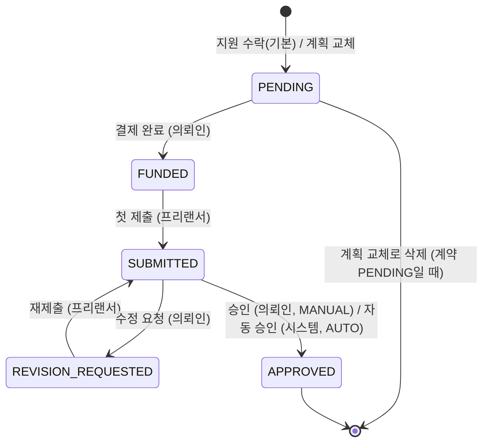
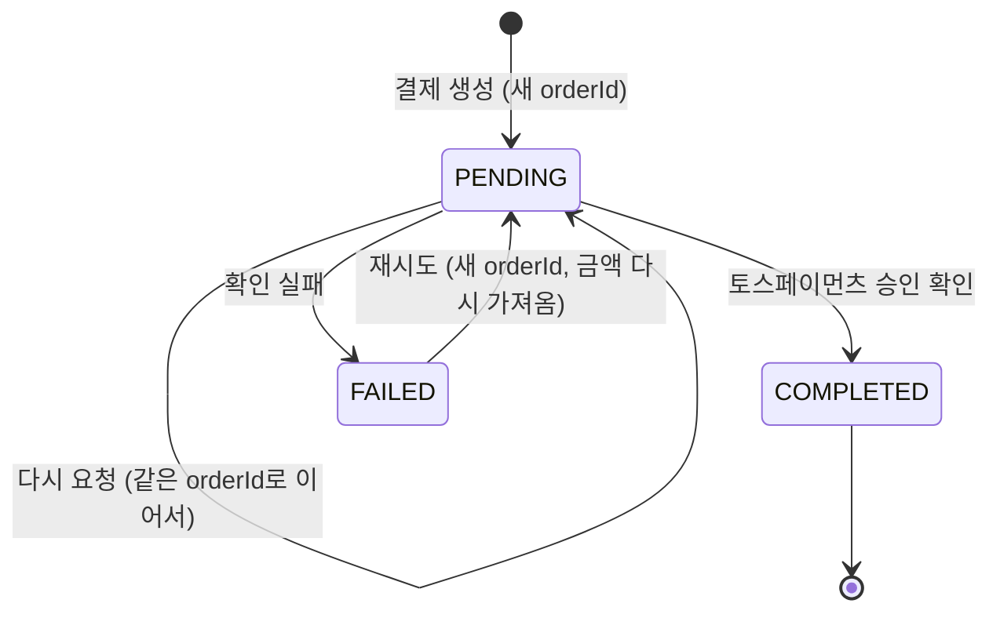
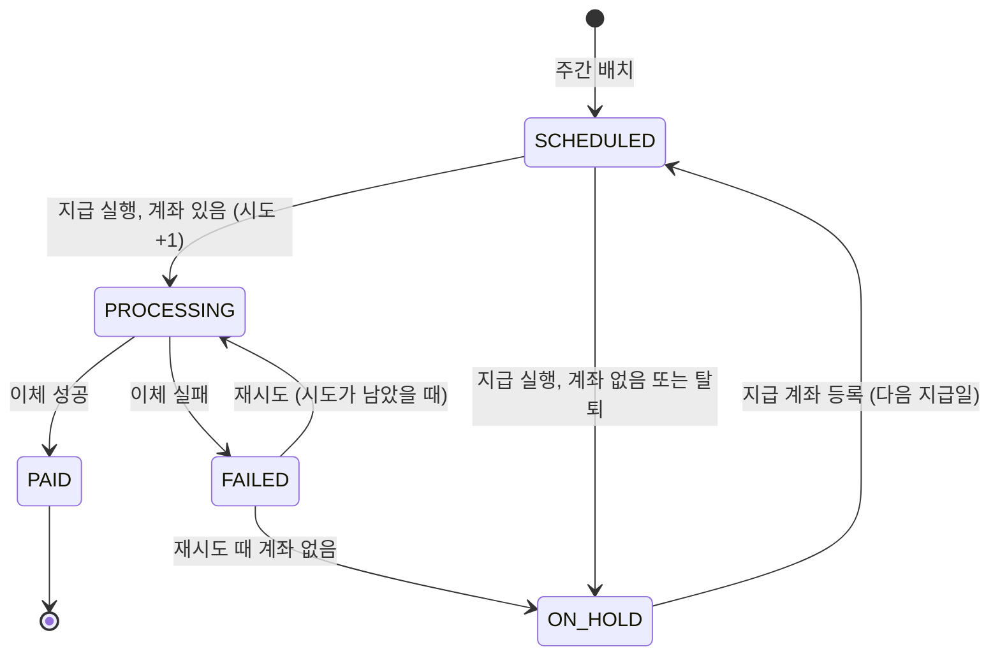

# 마일스톤, 안전결제, 정산

계약 금액은 마일스톤으로 나뉘고, 의뢰인은 마일스톤마다 대금을 먼저 결제한다(안전결제). 프리랜서가 결과물을
제출하고 의뢰인이 승인하면(기한 안에 판단이 없으면 자동 승인) 그 금액이 수수료를 뺀 정산 항목이 되고, 매주 한 번
묶여 프리랜서의 지급 계좌로 나간다.

## 돈 규칙

모든 금액은 **원 단위 정수**이고 계산은 basis point 정수 연산이다. 수수료·부가세·반올림은 `src/lib/money.ts`만
거친다. DB 금액 컬럼이 `Float`인 것은 알고 있는 부채이고([DATABASE.md](../DATABASE.md#금액이-float인-부채)), 새로
쓰는 값은 항상 정수다.

- **플랫폼 수수료와 그 부가세는 프리랜서가 부담한다.** 의뢰인은 마일스톤 금액만 낸다. 요율은
  `PLATFORM_FEE_RATE_BPS`, `FEE_VAT_RATE_BPS`이고, 원 미만은 버린다(`payoutBreakdown()`).
- 정산 항목은 **승인 시점의 요율을 저장한다**(`SettlementItem.feeRateBps`). 요율이 바뀌어도 이미 만든 항목은 그대로다.
- **정산 합계는 항목에 저장된 값의 합이다**(`sumBreakdowns()`). 합계 금액에서 다시 계산하지 않는다. 예를 들어
  15,005원짜리 항목 두 건은 각각 수수료가 1,500원이라 정산의 수수료는 3,000원이다. 합계 30,010원에서 다시 계산하면
  3,001원이 된다. 프리랜서가 건별로 본 금액과 정산서의 금액이 항상 맞아야 하기 때문이다.
- 계약 금액은 소수일 수 있어서, 마일스톤에 관한 계산(기본 마일스톤, 계획 합계, 서명 검사)은 모두 원 단위로 반올림한
  값(`wholeWon()`)을 쓴다.

## 마일스톤 계획

계약이 `PENDING`(서명 전)인 동안 의뢰인이 계획 전체를 바꿀 수 있다. 계획을 바꾸면 양측 서명이 초기화된다
([projects-contracts.md](projects-contracts.md#서명과-계획-교체)). 마일스톤 금액의 합은 항상 계약 금액(원)과 같다.
개수, 금액, 기한의 한도는 `src/lib/money.ts`와 `src/schemas/milestones.ts`에 있다.

마일스톤 최소 금액(`MIN_MILESTONE_AMOUNT`)은 의뢰인이 바꾼 계획에만 적용하고, 수락 때 생기는 기본 마일스톤에는
적용하지 않는다. 그래서 최소 금액보다 작은 계약도 기본 마일스톤 하나로 진행할 수 있다.

## 마일스톤 상태

- `APPROVED`는 최종이다. 환불, 분쟁, 취소 경로는 없다. **계약 취소와 환불은 앱 기능으로 두지 않는다.** 당사자가
  고객센터로 요청하면 운영팀이 토스 대시보드에서 결제를 취소하고 계약과 마일스톤을 정리한다. 요청이 드물고 사정마다
  판단이 필요해서, 초기 마켓플레이스에서는 자동화보다 사람이 처리하는 편이 낫다고 봤다.
- 모든 전이는 기대 상태를 조건으로 거는 쓰기다([README](README.md#원자성)). 예외는 결제로 인한 `PENDING → FUNDED`로,
  경합에서 지면 오류 없이 아무것도 하지 않는다(아래 "결제 확인").

## 안전결제

**결제는 마일스톤 단위다.** 계약 하나에 결제가 여러 건이고 마일스톤마다 결제는 하나다(`Payment.milestoneId` 유일).
결제 금액은 항상 마일스톤 금액이고 **요청 본문의 금액을 쓰지 않는다.** 그 계약의 의뢰인만 결제한다.

- 계약이 `ACTIVE`여야 결제할 수 있다(양측이 서명한 조건에만 돈을 낸다).
- **순서대로만 결제한다.** 앞 순번 마일스톤이 아직 `PENDING`이면 뒤 마일스톤을 결제할 수 없다. 프리랜서는 결제된
  만큼만 일한다.
- 이미 결제된 마일스톤은 다시 결제할 수 없다. 같은 마일스톤에 동시에 결제를 만들어도 하나만 생긴다.

### 결제 확인

- 토스페이먼츠가 `DONE`을 보고하고 금액이 저장된 금액과 같을 때만 완료한다. 의뢰인이 마일스톤 금액보다 적게 낼 수 없다.
- 프로젝트가 삭제된 마일스톤은 공급자에게 연락하기 **전에** 거절한다. 삭제된 프로젝트에 돈을 받지 않는다.
- 성공하면 한 트랜잭션에서 결제가 `COMPLETED`, 마일스톤이 `FUNDED`가 되고 알림과 기한 알림 작업이 생긴다.
- 확인은 **한 번만 처리된다.** 동시에 두 번 확인해도 하나만 공급자에게 가고 나머지는 충돌로 끝난다(선점과 타임아웃은
  `src/controllers/payments.controller.ts`의 주석). 어떤 경우에도 결제는 `COMPLETED`, 마일스톤은 `FUNDED`, 알림과
  작업은 한 번씩이다. 마일스톤이 이미 결제됐으면 결제 처리 단계는 아무것도 하지 않는다. 예외를 던지면 이긴 쪽 결제를
  `FAILED`로 덮어쓰게 된다.
- 확인에 실패하면 결제를 `FAILED`로 바꾼다. 이 쓰기도 결제가 아직 `PENDING`일 때만 한다. 경합에서 진 확인이 이긴
  쪽의 `COMPLETED`를 되돌리면 안 된다.

### 개발용 결제 우회

`ALLOW_PAYMENT_BYPASS`가 정확히 `true`일 때만, 토스페이먼츠 없이 결제를 완료하고 마일스톤을 결제 상태로 만든다.
**운영에서는 반드시 꺼 둔다.** 계약·순서·소유권 규칙은 실제 결제와 같다.

## 제출과 검수

- 프리랜서는 마일스톤이 `FUNDED` 또는 `REVISION_REQUESTED`일 때 제출한다. **기한이 지나도 제출을 받는다.** 늦은
  제출에 벌칙은 없다.
- 제출은 메시지, 링크, 첨부로 이루어지고 회차(`round`)가 하나씩 늘어난다. 한도는 `src/schemas/milestones.ts`에 있다.
  첨부는 메시지 첨부와 같은 방식이다([messaging-notifications.md "첨부 파일"](messaging-notifications.md#첨부-파일)).
- 의뢰인은 `SUBMITTED`인 마일스톤을 승인하거나 수정을 요청한다. 수정 요청 사유에는 최소 길이가 있다. 무엇을 고칠지
  말하게 하려는 하한이다. 수정 요청 횟수는 무제한이고 `revisionCount`는 기록용이다.

### 자동 승인과 기한 알림

의뢰인이 검수를 미뤄 프리랜서의 돈이 묶이지 않게 하는 장치다. 제출 후 일정 기간(`MILESTONE_AUTO_APPROVE_DAYS`,
`autoApproveDays()`) 안에 판단이 없으면 시스템이 승인하고, 그 전에 의뢰인에게 예고한다(`AUTO_APPROVE_REMINDER_MS`).
결제된 마일스톤의 기한이 다가오면 프리랜서에게(`DUE_SOON_MS`), 기한이 지나면 양측에 알린다. 상수는
`src/services/milestones.service.ts`에 있다.

- 수정을 요청하면 그 회차의 자동 승인은 없어지고, 재제출하면 새 기간이 시작된다.
- 기한 알림은 마일스톤이 아직 `FUNDED`·`REVISION_REQUESTED`일 때만 보낸다. 기한이 지난 마일스톤은 당사자끼리 새
  일정을 합의하라는 신호이고, 시스템이 벌칙을 매기지 않는다.
- 자동 승인은 프로젝트가 삭제됐어도, 당사자가 탈퇴했어도 진행한다. 이미 결제된 돈을 묶지 않는다.

### 승인과 계약 완료

승인(수동·자동)은 한 트랜잭션에서 마일스톤을 `APPROVED`로 바꾸고 프리랜서의 **정산 항목**을 만든다. 승인되지 않은
마일스톤이 남지 않았으면 같은 트랜잭션에서 계약과 프로젝트를 `COMPLETED`로 바꾼다. 이때부터 리뷰를 쓸 수 있다.

수동 승인과 자동 승인이 겹쳐도, 마지막 두 마일스톤이 동시에 승인돼도 정산 항목은 마일스톤마다 하나, 계약 완료
알림은 당사자당 한 번이다. 모든 마일스톤이 승인됐는데 계약이 `ACTIVE`로 남는 일은 없다.

프로젝트가 삭제된 계약의 자동 승인은 계약을 완료하고 정산 항목도 만들지만, 삭제된 프로젝트 행은 건드리지 않고
그 승인에 대한 알림과 시스템 메시지는 남기지 않는다. 링크할 화면이 없기 때문이다.

## 정산

정산은 프리랜서 한 명의 한 주(월~일, KST)치 정산 항목 묶음이고 한 번에 지급된다. 주가 끝난 다음 월요일 새벽에
배치가 정산을 만들고, 그 주 수요일 오전에 지급한다. 시각과 재시도 횟수·간격은 `src/services/settlements.service.ts`의
상수에 있다.

- 정산은 프리랜서와 기간마다 하나다. 배치를 다시 돌려도 중복되지 않고, 배치가 놓친 항목은 다음 배치가 따라잡는다.
  한 항목이 두 정산에 들어가는 일은 없다.

- 지급할 때 그 시점의 계좌를 정산에 스냅샷한다(은행 이름, 마스킹한 번호, 예금주). 전체 계좌번호는 정산에 남기지 않는다.
- 시도를 다 쓰고도 실패하면 최종 `FAILED`이고 프리랜서에게 알린다. 그 뒤는 운영자가 처리한다. 중간 실패는 알리지 않는다.
- **`PROCESSING`에서 멈춘 정산은 자동으로 다시 시도하지 않는다.** 돈이 나갔는지 알 수 없고, 두 번 지급하는 것이
  기다리는 것보다 나쁘다.
- 지금 지급 provider는 이체를 로그로만 남기고 성공으로 보고한다. 운영에서는 지급 작업 자체가 플래그로 꺼져 있다([jobs.md](jobs.md#플래그로-꺼-둔-작업)).

## 지급 계좌

프리랜서마다 계좌 하나다. 정산금은 등록한 계좌로만 나간다. 은행은 고정 목록(`BANKS`, `src/lib/banks.ts`) 중 하나다.

- **예금주는 회원 본인이어야 한다.** 공백과 대소문자를 무시하고 프로필 이름과 같아야 한다.
- 계좌번호는 어떤 응답, 로그, 정산에도 전체가 나가지 않는다. 마지막 네 자리만 보인다. DB에는 **암호화해 저장한다**
  ([DATABASE.md](../DATABASE.md#지급-계좌번호-암호화)).
- **지급이 `PROCESSING`인 동안에는 계좌를 바꾸거나 지울 수 없다.** 다른 상태의 정산은 지급 시점에 있는 계좌를 쓴다.
  계좌 변경과 지급 결정은 같은 사용자 행 잠금을 잡아 섞이지 않는다.
- 계좌를 등록하면 그 프리랜서의 보류(`ON_HOLD`) 정산이 모두 지급 예정으로 돌아가 다음 지급일에 다시 잡힌다.
