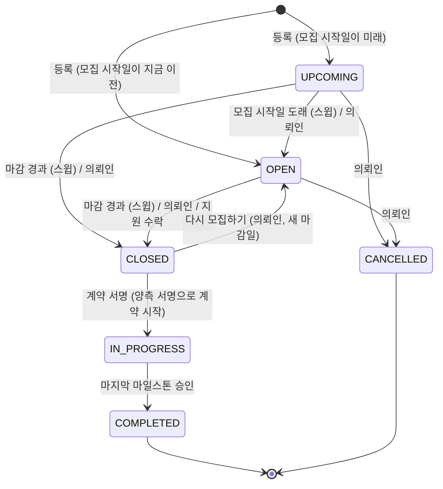
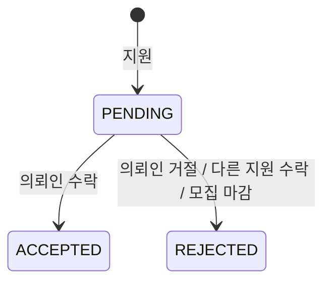
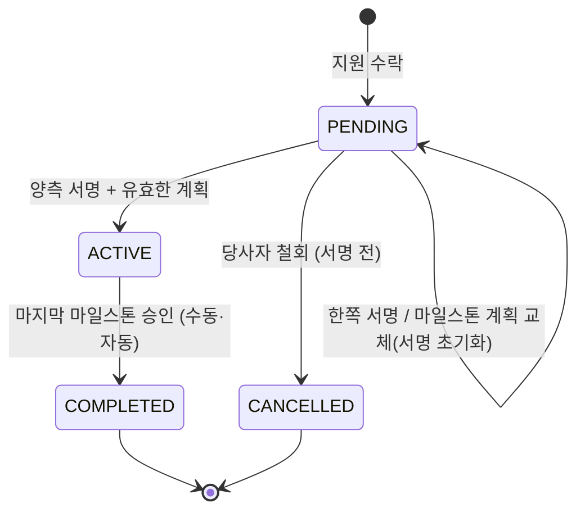

# 프로젝트, 지원, 계약

의뢰인이 프로젝트를 올리면 모집 기간 동안 프리랜서가 지원하고, 의뢰인이 한 명을 수락하는 순간 계약과 기본
마일스톤, 대화방이 함께 생기고 모집이 끝난다. 계약은 양측이 서명하면 시작되고, 마지막 마일스톤이 승인되면 자동으로
완료되어 서로 리뷰를 남길 수 있다. 양측이 서명하기 전에는 어느 쪽이든 계약을 철회할 수 있고, 의뢰인은 그 프로젝트로
다시 모집할 수 있다.

## 프로젝트 수명주기

- 모집 시작일과 마감일은 KST 날짜다([README](README.md#시간대)). 오늘 마감인 프로젝트는 오늘이 끝날 때까지 `OPEN`이다.
- 등록·수정·다시 모집하기 모두 이미 지난 마감일은 받지 않는다(오늘은 된다). 받으면 지연 스윕이 곧바로 닫아, 등록하자마자
  모집이 끝난 프로젝트가 생기기 때문이다.
- 계약 금액은 예산이 아니라 수락된 지원의 희망 금액이다.
- `CLOSED`는 "모집이 끝났다"는 뜻이다. 지원을 수락해 서명을 기다리는 프로젝트, 서명 전에 계약이 철회된 프로젝트,
  마감까지 아무도 수락하지 않은 프로젝트가 여기 있다. 양측 서명으로 계약이 `ACTIVE`가 되는 트랜잭션에서 프로젝트는 `IN_PROGRESS`("진행 중")가
  되고, 마지막 마일스톤이 승인되면 `COMPLETED`가 된다.
- 의뢰인이 손으로 옮길 수 있는 것은 위 그림의 "의뢰인" 화살표뿐이다(`validTransitions`,
  `src/services/projects.service.ts`). 특히 진행 중인 프로젝트를 손으로 완료하거나 취소하면 마일스톤을
  건너뛰거나 진행 중인 계약을 남겨 두게 되므로 막는다. 스윕, 지원 수락, 계약 서명, 마지막 마일스톤 승인 같은
  시스템 전이는 이 표를 보지 않는다.
- 의뢰인이 `CLOSED`나 `CANCELLED`로 옮기면 대기 지원을 모두 거절하고, 대기 중이던 지원자마다 `PROJECT_STATUS_CHANGED`를
  보낸다. 취소된 프로젝트에 대기 지원이 남아 수락되는 일이 없도록 하기 위해서다.

### 지연 스윕: 읽기가 행을 쓴다

프로덕션에는 상주 작업 프로세스가 없어서, 시각에 맞춰 프로젝트 상태를 바꿔 줄 주체가 없다. 그래서 **프로젝트를 읽는
경로가 응답 전에 상태를 맞춘다.** 이것을 지연 스윕이라고 부른다. `closeExpiredOpenProjects(now)`
(`src/lib/projectLifecycle.ts`)가 한 트랜잭션에서 세 가지를 한다.

1. 모집 시작일이 된 `UPCOMING`을 `OPEN`으로 연다.
2. 마감이 지난 프로젝트를 `CLOSED`로 바꾼다.
3. 그 프로젝트의 대기 중인 지원을 알림 없이 거절한다.

프로젝트 목록·상세를 비롯해 프로젝트나 지원을 읽는 여러 경로가 이 스윕을 먼저 돌린다. 지원 거절만 하는
`rejectPendingApplicationsForClosedProjects`를 돌리는 경로도 있다. 어느 경로인지는 두 함수의 호출부를 본다.
즉 **프로젝트 목록과 상세 조회는 읽기 전용이 아니다.**

작업 큐의 `project.lifecycleSweep`도 같은 함수를 주기적으로 돌린다([jobs.md](jobs.md)). 그것은 아무도 읽지 않을 때
상태를 맞춰 두는 보조 장치이고, 보장은 읽기 경로의 스윕이 한다. 스윕은 멱등이라 둘이 어떤 순서로 겹쳐도 결과가 같다.
추천과 대화방 조회는 스윕을 돌리지 않는 진짜 읽기 전용이다.

결과적으로 **의뢰인은 마감 전에 지원자를 골라야 한다.** 마감이 지나면 남은 지원은 모두 거절된다.

### 수정과 삭제

- 제목, 설명, 카테고리, 요구 기술은 어떤 상태에서도 고칠 수 있다(완료·취소 포함, 의도된 동작).
- **지원이 하나라도 들어오면 예산, 모집 시작일, 마감일은 바꿀 수 없다.** 지원한 프리랜서가 보지 못한 사이에 조건이
  바뀌면 안 되기 때문이다.
- 삭제는 소프트 삭제다. **계약이 하나라도 있는 프로젝트는 지울 수 없다**(서명 대기·진행 중·완료·철회 모두). 프로젝트를
  지우면 그 계약, 계약을 가리키는 알림의 링크, 대화방이 상대방에게서도 사라진다. 계약은 서명 전에 철회됐더라도 금액과 계획,
  서명 여부, 대화가 남은 두 당사자의 기록이라, 한쪽이 지울 수 있으면 안 된다. 모집을 끝내려면 모집을 마감한다.
- 의뢰인이 탈퇴할 때 프로젝트를 어떻게 정리하는지는 [accounts.md](accounts.md#막지-않고-정리하는-것)에 있다.
- 의뢰인이 손으로 모집을 마감하면 아직 결정되지 않은 지원만 거절되고, 그 지원자에게만 알린다. 이미 결과를 받은
  지원자(다시 모집하기 전에 거절된 지원자 포함)에게 같은 소식을 다시 보내지 않는다.

### 다시 모집하기

모집이 끝난(`CLOSED`) 프로젝트를 의뢰인이 **새 마감일**과 함께 다시 모집 중(`OPEN`)으로 돌린다. 서명 전 계약이
철회됐거나, 마감까지 아무도 고르지 못한 프로젝트를 같은 내용으로 다시 올리는 방법이다(#130).

한 프로젝트가 한 번 모집해 계약 하나를 맺기까지를 **모집 회차**라고 부른다. 그 계약이 철회되고 다시 모집하면 새 회차가
시작된다. 계약 없이 마감됐다가 다시 모집하면 회차는 그대로다. 코드에서는 프로젝트의 가장 최근 철회된 계약이 생긴
시각이 회차의 경계다(`src/lib/reapplication.ts`).

- **계약 철회가 모집을 자동으로 다시 열지 않는다.** 다시 모집할지는 의뢰인이 정한다. 자동으로 열면 의뢰인이 더는 원하지
  않을 수 있는 프로젝트를 다시 광고하게 되고, 철회한 쪽이 프리랜서일 때는 의뢰인이 모르는 사이에 지원이 들어온다.
- **새 마감일이 필요하다.** 원래 마감일은 이미 지났을 수 있고, 지났으면 지연 스윕이 곧바로 다시 닫는다. 그래서 다시
  모집할 때만은 지원이 있어도 마감일을 정한다(위 "지원이 하나라도 들어오면 마감일은 바꿀 수 없다"의 예외). 지난 날짜와
  모집 시작일보다 이른 날짜는 받지 않는다. 모집 시작일 전에 마감했던 프로젝트는 모집 예정으로 돌아간다.
- **철회되지 않은 계약(서명 대기 등)이 있으면 다시 모집할 수 없다.** 한 프로젝트에서 진행할 계약은 하나뿐이라, 먼저 그
  계약을 철회해야 한다.
- 다시 모집해도 아무에게도 알리지 않는다. 이전 지원자는 이미 결과를 받았고, 다시 지원할 수 있는 지원자는 내 지원 목록에서
  그것을 본다.
- **이전 회차에서 거절된 지원자는 다시 지원할 수 있다.** 철회된 계약이 생기기 전에 낸 지원이 거절됐으면(수락 때 함께
  거절됐거나 그 전에 거절됐으면) 다시 열린 모집에 다시 지원할 수 있다. 그 지원자에게 거절은 다른 지원자를 고른 결과였고,
  그 선택이 철회로 없어졌기 때문이다. 지원은 프로젝트마다 하나라서 행을 새로 만들지 않는다. 같은 지원이 새 내용의 대기
  지원으로 바뀌고, 다시 지원한 시각이 그 지원의 시각이 된다.
- **철회된 계약의 프리랜서와, 지금 회차에서 거절된 지원자는 다시 지원할 수 없다.** 앞의 사람은 스스로 철회했거나 의뢰인이
  철회한 상대이고, 뒤의 사람은 이번 모집에서 이미 결정을 받았다. 계약 없이 마감됐다가 다시 모집하는 프로젝트는 회차가
  바뀌지 않았으므로, 마감 때 거절된 지원자는 다시 지원할 수 없다.

## 북마크

프리랜서만 쓴다. 추가와 해제는 멱등이다. 이미 있는 북마크를 다시 추가해도, 없는 북마크를 해제해도 성공이다.
삭제된 프로젝트와 의뢰인이 삭제된 프로젝트는 상세 화면처럼 없는 프로젝트다. 북마크 여부 조회·추가·해제가 모두 404이고,
북마크 목록에서도 빠진다. 남아 있는 북마크 행은 지우지 않고 보이지 않게만 한다.

## 지원

- 프로필을 완성한 프리랜서만, `OPEN`이고 마감 전인 프로젝트에 한 번 지원한다.
- 희망 금액(`expectedRate`)이 계약 금액이 된다. 반올림해 0원이 되는 금액은 결제할 수 없는 마일스톤을 만들므로 받지 않는다.

결정된 지원은 다시 결정할 수 없다(예외: [다시 모집하기](#다시-모집하기)의 다시 지원). 한 프로젝트에서 진행할 수 있는
계약은 하나뿐이다. 철회된 계약은 기록으로 남고 세지 않는다. 프리랜서가 탈퇴할 때 지원이 어떻게 되는지는
[accounts.md](accounts.md#막지-않고-정리하는-것)에 있다.

### 수락: 계약 체결

수락은 시스템에서 가장 큰 상태 변경이고 **하나의 트랜잭션**이다. 이 지원을 수락하고 같은 프로젝트의 다른 대기 지원을
거절하고, 계약(`PENDING`)과 기본 마일스톤, 대화방을 만들고, 프로젝트를 `CLOSED`로 바꾸고, 지원자들에게 결과를
알린다. 같은 프로젝트의 서로 다른 지원을 동시에 수락해도 하나만 성공한다.

수락은 모집 중(`OPEN`이고 마감 전)인 프로젝트에서만 된다. 그 밖에는 409 `PROJECT_NOT_RECRUITING`이다. 지원 생성처럼
수락 전에 지연 스윕을 먼저 돌리므로, 마감이 지난 프로젝트의 결과가 스윕이 이미 돌았는지에 달려 있지 않다. 트랜잭션 안에서도
프로젝트 행을 잠근 뒤 상태를 다시 본다.

기본 마일스톤은 계약 금액 전체를 담은 마일스톤 하나이고, 기한은 수락한 날로부터 `DEFAULT_MILESTONE_DAYS`
(`src/services/milestones.service.ts`) 뒤다. 프로젝트 마감일은 이미 지났을 수 있어서 기한으로 쓰지 않는다.

## 계약

- 그림 밖의 전이는 없다. 시작된 계약의 취소와 환불을 운영팀이 처리하는 이유는
  [milestones-payments.md](milestones-payments.md#마일스톤-상태)에 있다. 서명 전 계약은 당사자가 앱에서 철회한다(아래).
  완료는 마지막 마일스톤 승인 트랜잭션 안에서만 일어난다([milestones-payments.md](milestones-payments.md#승인과-계약-완료)).
- 계약 금액은 저장된 그대로(소수일 수 있다) 두고, 마일스톤에 관한 모든 계산은 원 단위로 반올림한 값을 쓴다(`wholeWon`).
- 계약의 종료일은 항상 마지막 마일스톤의 기한이다. 수락 때 정하고, 계획을 바꿀 때마다 다시 정한다.
- 계약은 당사자(의뢰인, 프리랜서)만 본다. 계약 응답은 당사자의 이메일을 내보내지 않는다(#64). 당사자 간 연락은 앱의
  메시지로 한다. 플랫폼 밖 직거래를 막고 개인정보를 최소한으로 내보내기 위해서다. 마일스톤의 결제에서 토스 결제
  키(`paymentKey`)도 내보내지 않는다(양 당사자가 같은 응답을 받고, 결제 결과 화면은 토스가 돌려준 값을 쓴다).

### 서명과 계획 교체

- 각자 자기 서명만 한다. 같은 사람이 두 번 서명해도 바뀌는 것이 없다.
- **유효한 마일스톤 계획이 있어야 서명할 수 있다.** 마일스톤이 하나 이상이고, 모두 `PENDING`이고, 금액 합이 계약
  금액(원 단위)과 같아야 한다.
- 두 서명이 모이면 계약은 **정확히 한 번** `ACTIVE`가 되고, 같은 트랜잭션에서 프로젝트가 `IN_PROGRESS`가 된다.
  양측이 동시에 서명해도 결과는 같다.
- 의뢰인이 계획을 바꾸면 **양측 서명이 모두 초기화된다.** 바뀐 조건에는 둘 다 다시 서명해야 한다.
- 계약이 `ACTIVE`가 되면 계획은 잠긴다.

### 서명 전 철회

서명 대기(`PENDING`) 계약은 의뢰인과 프리랜서 어느 쪽이든 철회할 수 있다. 한쪽이 이미 서명했어도 된다.

- **왜 앱에서 하는가.** 시작된 계약의 취소를 운영팀에 맡기는 것은 결제를 되돌리고 한 작업을 따져야 하기 때문이다. 서명
  전 계약은 결제가 없고(결제는 계약이 시작된 뒤에만 된다) 작업도 시작되지 않아 정리할 것이 없다. 반대로 상대가 끝내
  서명하지 않은 계약이 남아 있으면 의뢰인은 그 프로젝트로 다른 사람과 계약할 수 없고, 양쪽 모두 탈퇴도 할 수 없다.
- **계약은 지우지 않고 철회됨(`CANCELLED`)으로 남긴다.** 누가 언제 철회했는지도 남는다. 금액, 마일스톤 계획, 서명 여부,
  대화는 두 당사자의 기록이다. 철회된 계약은 다시 살릴 수 없고, 다시 거래하려면 새 지원과 수락을 거친다.
- **프로젝트는 모집 마감 상태로 남는다.** 다시 모집할지는 의뢰인이 정한다([다시 모집하기](#다시-모집하기)).
- **기본 마일스톤(또는 바뀐 계획)은 그대로 둔다.** 철회 시점의 조건 기록이다. 결제는 시작된 계약에만, 제출과 승인은 결제된
  마일스톤에만 되므로 철회된 계약의 마일스톤은 다시 움직이지 않는다. 그래서 마일스톤에 따로 상태를 두지 않는다.
- **대화방은 남는다.** 완료된 계약처럼 읽기는 계속 되고, 보내기는 철회한 때부터 같은 기간 동안만 된다
  ([messaging-notifications.md](messaging-notifications.md#누가-보낼-수-있나)).
- **상대방에게 알린다.** 거래 알림이라 인앱은 끌 수 없다. 철회는 대화방에 시스템 메시지로도 남는다.
- 서명과 철회, 계획 교체와 철회, 양쪽의 동시 철회는 하나만 이긴다. 계약이 먼저 시작됐으면 철회가 충돌로 끝나고, 철회가
  먼저면 서명과 계획 교체가 충돌로 끝난다.

## 리뷰

- 계약이 `COMPLETED`가 된 뒤에만 쓴다. 당사자 각자가 **상대방에 대해** 계약당 한 번 쓴다.
- 받은 리뷰는 공개다. 공개 프로필의 평균 평점과 리뷰 수가 이것을 쓴다.

## 추천

프로필을 완성한 프리랜서에게 맞는 프로젝트를 추천한다. 기술·분야·최신성 등으로 점수를 매겨 높은 순으로 준다. 점수 산식은
`scoreProject`의 주석에, 후보 조건은 `recommendProjects`의 조회 조건에 있다(둘 다 `src/lib/recommendations.ts`).
읽기 전용이라 스윕을 돌리지 않는다. 그래서 마감이 지났지만 아직 `OPEN`인 프로젝트는 상태가 아니라 마감일로 거른다.
