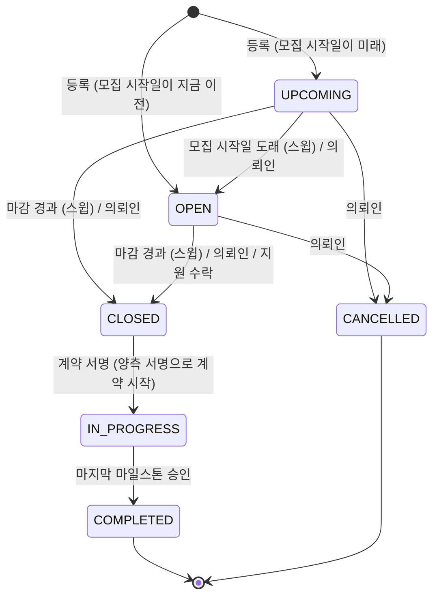
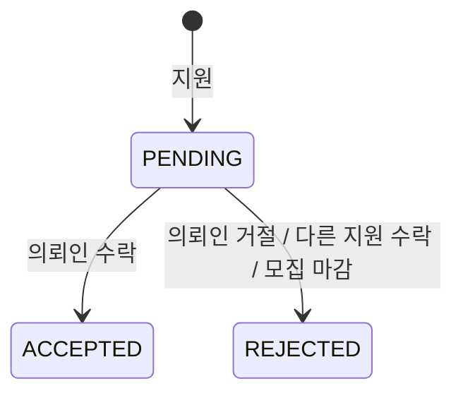
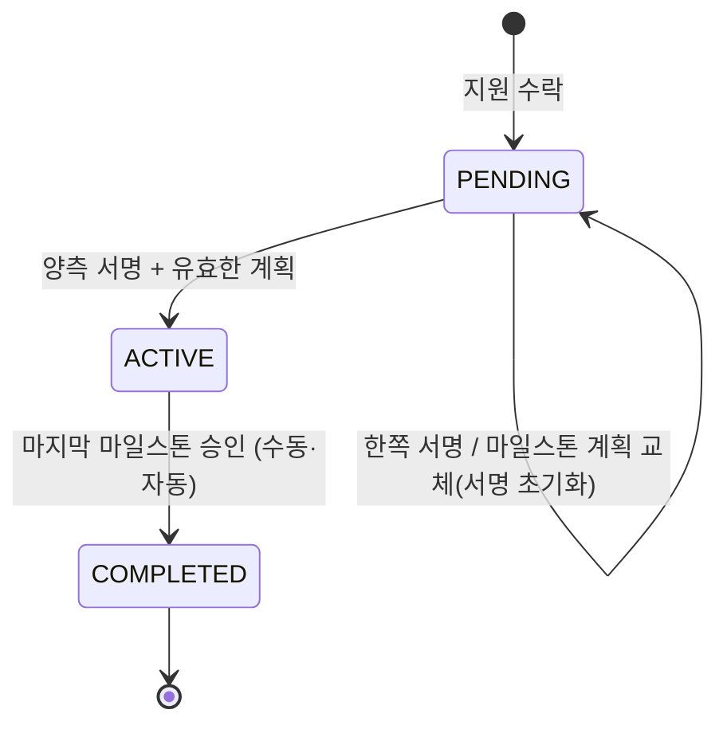

# 프로젝트, 지원, 계약

의뢰인이 프로젝트를 올리면 모집 기간 동안 프리랜서가 지원하고, 의뢰인이 한 명을 수락하는 순간 계약과 기본
마일스톤, 대화방이 함께 생기고 모집이 끝난다. 계약은 양측이 서명하면 시작되고, 마지막 마일스톤이 승인되면 자동으로
완료되어 서로 리뷰를 남길 수 있다.

## 프로젝트 수명주기

- 모집 시작일과 마감일은 KST 날짜다([README](README.md#시간대)). 오늘 마감인 프로젝트는 오늘이 끝날 때까지 `OPEN`이다.
- 계약 금액은 예산이 아니라 수락된 지원의 희망 금액이다.
- `CLOSED`는 "모집이 끝났다"는 뜻이다. 지원을 수락해 서명을 기다리는 프로젝트와, 마감까지 아무도 수락하지 않은
  프로젝트가 여기 있다. 양측 서명으로 계약이 `ACTIVE`가 되는 트랜잭션에서 프로젝트는 `IN_PROGRESS`("진행 중")가
  되고, 마지막 마일스톤이 승인되면 `COMPLETED`가 된다.
- 의뢰인이 손으로 옮길 수 있는 것은 위 그림의 "의뢰인" 화살표뿐이다(`validTransitions`,
  `src/controllers/projects.controller.ts`). 특히 진행 중인 프로젝트를 손으로 완료하거나 취소하면 마일스톤을
  건너뛰거나 진행 중인 계약을 남겨 두게 되므로 막는다. 스윕, 지원 수락, 계약 서명, 마지막 마일스톤 승인 같은
  시스템 전이는 이 표를 보지 않는다.

### 지연 스윕: 읽기가 행을 쓴다

운영에는 상주 작업 프로세스가 없어서 시각에 맞춰 상태를 바꿔 줄 주체가 없다. 그래서 **프로젝트를 읽는 경로가 먼저
상태를 맞춘다.** `closeExpiredOpenProjects(now)`(`src/lib/projectLifecycle.ts`)가 모집 시작일이 된 `UPCOMING`을
열고, 마감이 지난 프로젝트를 `CLOSED`로 바꾸고, 그 프로젝트의 대기 중인 지원을 알림 없이 거절한다.

프로젝트 목록·상세를 비롯해 프로젝트나 지원을 읽는 여러 경로가 이 스윕(또는 지원 거절만 하는
`rejectPendingApplicationsForClosedProjects`)을 먼저 돌린다. 어느 경로인지는 `src/lib/projectLifecycle.ts` 함수의
호출부를 본다. 즉 **프로젝트 목록과 상세 조회는 읽기 전용이 아니다.** 작업 큐의 `project.lifecycleSweep`도 같은 함수를 주기적으로 돌리지만([jobs.md](jobs.md)), 그것은
아무도 읽지 않을 때 상태를 맞춰 두는 보조 장치이고 보장은 읽기 경로의 스윕이다. 스윕은 멱등이라 둘이 어떤 순서로
겹쳐도 결과가 같다. 추천과 대화방 조회는 스윕을 돌리지 않는 진짜 읽기 전용이다.

결과적으로 **의뢰인은 마감 전에 지원자를 골라야 한다.** 마감이 지나면 남은 지원은 모두 거절된다.

### 수정과 삭제

- 제목, 설명, 카테고리, 요구 기술은 어떤 상태에서도 고칠 수 있다(완료·취소 포함, 의도된 동작).
- **지원이 하나라도 들어오면 예산, 모집 시작일, 마감일은 바꿀 수 없다.** 지원한 프리랜서가 보지 못한 사이에 조건이
  바뀌면 안 되기 때문이다.
- 삭제는 소프트 삭제다. **완료되지 않은 계약(`PENDING`·`ACTIVE`)이 있는 프로젝트는 지울 수 없다.** 진행 중이거나
  서명 대기인 상대방의 계약을 지워 버리면 안 된다. 계약이 완료된 프로젝트는 지울 수 있다.

## 북마크

프리랜서만 쓴다. 추가와 해제는 멱등이다. 이미 있는 북마크를 다시 추가해도, 없는 북마크를 해제해도 성공이다.
삭제된 프로젝트와 의뢰인이 삭제된 프로젝트는 상세 화면처럼 없는 프로젝트다. 북마크 여부 조회·추가·해제가 모두 404이고,
북마크 목록에서도 빠진다. 남아 있는 북마크 행은 지우지 않고 보이지 않게만 한다.

## AI 단가 분석

의뢰인이 자기 프로젝트의 기능별 예상 단가를 OpenAI(`gpt-4o-mini`)로 받는다.

- **의뢰인의 예산은 모델에 주지 않는다.** 예산에 끌려가지 않는 독립적인 시세를 받기 위해서다.
- 모델 출력은 믿지 않는다. 기능마다 형태를 맞추고, 예상 금액이 0 이하인 기능은 버리고, **총액은 남은 기능 금액의
  합으로 다시 계산한다.** 요약 문장 중 원 금액을 말하는 문장은 지운다(총액과 어긋나는 숫자를 보여주지 않기 위해).
- 프로젝트마다 결과는 하나이고, 다시 분석하면 덮어쓴다.
- 공급자 쪽 실패(호출 실패, 빈 응답, JSON이 아님, 쓸 만한 기능 없음)는 외부 서비스 오류(502)이고 서버 오류가 아니다.
  공급자의 원문은 응답에 싣지 않고, 아무것도 저장하지 않는다(이전 결과가 있으면 그대로 둔다).
- 비용이 요청마다 들기 때문에 사용자별로 시간당·KST 하루당 횟수를 제한한다(`ANALYZE_HOURLY_RULE`,
  `ANALYZE_DAILY_RULE`, `src/lib/rateLimitRules.ts`). 역할 확인을 통과한 모든 호출이 센다. 공급자 실패도 포함이다.

## 지원

- 프로필을 완성한 프리랜서만, `OPEN`이고 마감 전인 프로젝트에 한 번 지원한다.
- 희망 금액(`expectedRate`)이 계약 금액이 된다. 반올림해 0원이 되는 금액은 결제할 수 없는 마일스톤을 만들므로 받지 않는다.

결정된 지원은 다시 결정할 수 없다. 한 프로젝트에는 계약이 하나뿐이다(`Contract.projectId` 유일).

### 수락: 계약 체결

수락은 시스템에서 가장 큰 상태 변경이고 **하나의 트랜잭션**이다. 이 지원을 수락하고 같은 프로젝트의 다른 대기 지원을
거절하고, 계약(`PENDING`)과 기본 마일스톤, 대화방을 만들고, 프로젝트를 `CLOSED`로 바꾸고, 지원자들에게 결과를
알린다. 같은 프로젝트의 서로 다른 지원을 동시에 수락해도 하나만 성공한다.

기본 마일스톤은 계약 금액 전체를 담은 마일스톤 하나이고, 기한은 수락한 날로부터 `DEFAULT_MILESTONE_DAYS`
(`src/services/milestones.service.ts`) 뒤다. 프로젝트 마감일은 이미 지났을 수 있어서 기한으로 쓰지 않는다.

## 계약

- 다른 전이는 없다. 계약을 손으로 완료하는 방법도, 취소·해지 상태도 없다. 계약 취소와 환불은 앱 기능으로
  두지 않고 운영팀이 처리한다([milestones-payments.md](milestones-payments.md#마일스톤-상태)). 완료는 마지막 마일스톤 승인 트랜잭션
  안에서만 일어난다([milestones-payments.md](milestones-payments.md#승인과-계약-완료)).
- 계약 금액은 저장된 그대로(소수일 수 있다) 두고, 마일스톤에 관한 모든 계산은 원 단위로 반올림한 값을 쓴다(`wholeWon`).
- 계약의 종료일은 항상 마지막 마일스톤의 기한이다. 수락 때 정하고, 계획을 바꿀 때마다 다시 정한다.
- 계약은 당사자(의뢰인, 프리랜서)만 본다. 계약 응답은 당사자의 이메일을 내보내지 않는다. 당사자 간 연락은 앱의
  메시지로 한다. 플랫폼 밖 직거래를 막고 개인정보를 최소한으로 내보내기 위해서다. 마일스톤의 결제에서 토스 결제
  키(`paymentKey`)도 내보내지 않는다(양 당사자가 같은 응답을 받고, 결제 결과 화면은 토스가 돌려준 값을 쓴다).

### 서명과 계획 교체

- 각자 자기 서명만 한다. 같은 사람이 두 번 서명해도 바뀌는 것이 없다.
- **유효한 마일스톤 계획이 있어야 서명할 수 있다.** 마일스톤이 하나 이상이고, 모두 `PENDING`이고, 금액 합이 계약
  금액(원 단위)과 같아야 한다.
- 두 서명이 모이면 계약은 **정확히 한 번** `ACTIVE`가 되고, 같은 트랜잭션에서 프로젝트가 `IN_PROGRESS`가 된다.
  양측이 동시에 서명해도 결과는 같다.
- 의뢰인이 계획을 바꾸면 **양측 서명이 모두 초기화된다.** 바뀐 조건에는 둘 다 다시 서명해야 한다.
- 계약이 `ACTIVE`가 되면 계획은 잠긴다.

## 리뷰

- 계약이 `COMPLETED`가 된 뒤에만 쓴다. 당사자 각자가 **상대방에 대해** 계약당 한 번 쓴다.
- 받은 리뷰는 공개다. 공개 프로필의 평균 평점과 리뷰 수, 프리랜서 추천 점수가 이것을 쓴다.

## 추천

두 추천 모두 읽기 전용이고(스윕을 돌리지 않는다), 기술·분야·평판 등으로 100점 만점 점수를 매겨 높은 순으로 준다.
점수 산식과 후보 조건은 `src/lib/recommendations.ts`(`scoreFreelancer`, `scoreProject`)의 주석에 있다.

- **프로젝트에 맞는 프리랜서**는 그 프로젝트의 의뢰인만 본다. 이메일은 내보내지 않는다.
- **나에게 맞는 프로젝트**는 프로필을 완성한 프리랜서가 본다. 이미 지원한 프로젝트와 모집이 끝난 프로젝트는 빠진다.
