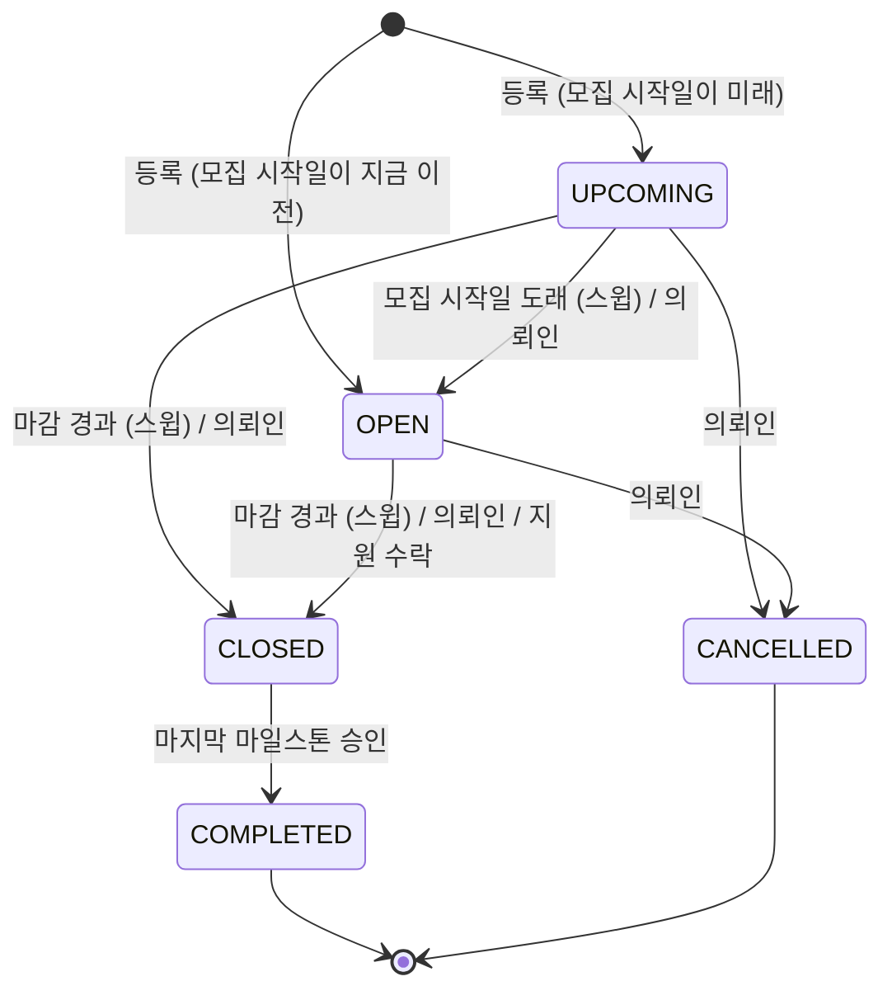
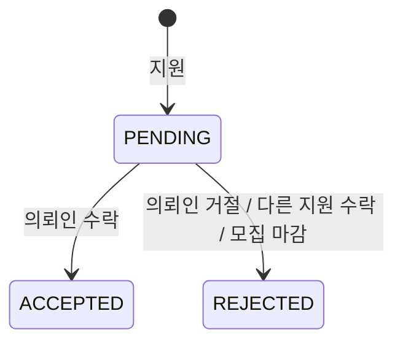
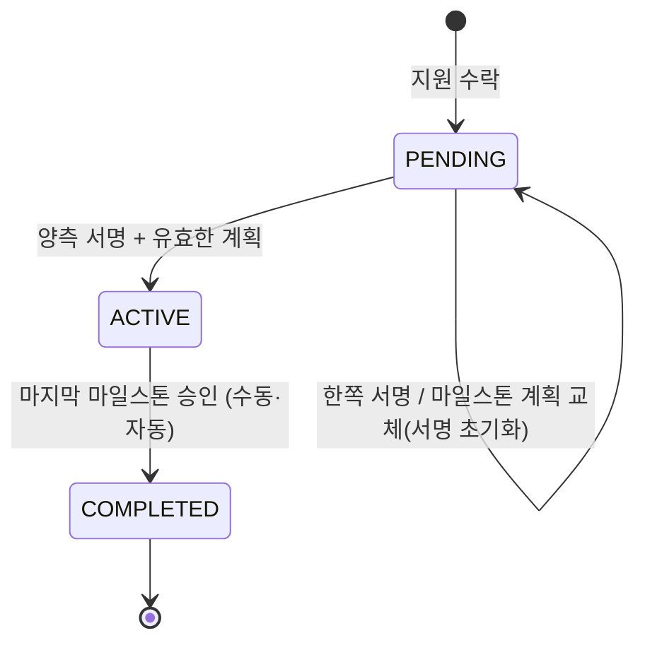

# 프로젝트, 지원, 계약

의뢰인이 프로젝트를 올리면 모집 기간 동안 프리랜서가 지원하고, 의뢰인이 한 명을 수락하는 순간 계약과 기본
마일스톤, 대화방이 함께 생기고 모집이 끝난다. 계약은 양측이 서명하면 시작되고, 마지막 마일스톤이 승인되면 자동으로
완료되어 서로 리뷰를 남길 수 있다.

## 프로젝트 수명주기

- 등록 시 모집 시작일을 생략하면 지금이다. 시작일이 마감일보다 늦을 수 없다. 날짜만 준 값은 KST 그 하루로 읽는다:
  오늘 마감인 프로젝트는 오늘 23:59:59.999 KST까지 `OPEN`이고, 오늘 시작하는 프로젝트는 바로 `OPEN`이다.
- 예산은 1원 이상의 원 단위 정수다(0원은 거절). 이 하한은 등록과 예산 수정에만 적용하고, 규칙 전에 0원으로
  저장된 프로젝트는 예산을 수정할 때까지 그대로 둔다. 계약 금액은 예산이 아니라 수락된 지원의 희망 금액이다.
- `CLOSED`는 "모집이 끝났다"는 뜻이고, 계약이 진행 중인 프로젝트도 `CLOSED`다. `IN_PROGRESS`는 enum과 수동 전이
  표에만 있고 지금 아무것도 이 상태를 쓰지 않는다. 계약 서명 때 `IN_PROGRESS`로 바꾸는 일은 [#46]에서 한다.
- 의뢰인의 수동 전이는 위 그림의 "의뢰인" 화살표뿐이다(`validTransitions`, `src/controllers/projects.controller.ts`).
  `COMPLETED`, `CANCELLED`, `CLOSED`에서는 손으로 옮길 수 없다. 이 표는 수동 전이만 다스린다. 스윕, 지원 수락,
  마지막 마일스톤 승인 같은 시스템 전이는 이 표를 보지 않는다(그래서 `CLOSED → COMPLETED`가 가능하다).
- 의뢰인이 손으로 모집을 마감하거나 프로젝트를 취소하면 대기 중인 지원을 모두 거절하고, 지원자마다 한 번
  `PROJECT_STATUS_CHANGED`를 보낸다(현재 다름: 취소는 지원을 그대로 둔다 [#43]).

### 지연 스윕: 읽기가 행을 쓴다

운영에는 상주 작업 프로세스가 없어서 시각에 맞춰 상태를 바꿔 줄 주체가 없다. 그래서 **프로젝트를 읽는 경로가 먼저
상태를 맞춘다.** `closeExpiredOpenProjects(now)`(`src/lib/projectLifecycle.ts`)가 하는 일:

1. 모집 시작일이 지났고 마감 전인 `UPCOMING`을 `OPEN`으로.
2. 마감이 지난 `UPCOMING`·`OPEN`을 `CLOSED`로.
3. `CLOSED`가 된 프로젝트의 대기 중인 지원을 거절한다(알림은 보내지 않는다).

공개 목록, 상세, 지원, 내 지원 목록, 내 프로젝트 목록이 이 스윕을 먼저 돌린다. 즉 **프로젝트 목록과 상세 조회는
읽기 전용이 아니다.** 작업 큐의 `project.lifecycleSweep`도 10분마다 같은 함수를 돌리지만([jobs.md](jobs.md)), 그것은
아무도 읽지 않을 때 상태를 맞춰 두는 보조 장치이고 보장은 읽기 경로의 스윕이다. 스윕은 멱등이라 둘이 어떤 순서로
겹쳐도 결과가 같다. 추천과 대화방 조회는 스윕을 돌리지 않는 진짜 읽기 전용이다.

결과적으로 **의뢰인은 마감 전에 지원자를 골라야 한다.** 마감이 지나면 남은 지원은 모두 거절된다.

### 수정과 삭제

- 제목, 설명, 카테고리, 요구 기술은 어떤 상태에서도 고칠 수 있다(완료·취소 포함, 의도된 동작).
- **지원이 하나라도 들어오면 예산, 모집 시작일, 마감일은 바꿀 수 없다.** 지원한 프리랜서가 보지 못한 사이에 조건이
  바뀌면 안 되기 때문이다. 지원이 없으면 날짜를 바꿀 수 있고, 아직 `UPCOMING`·`OPEN`이면 새 일정으로 상태를 다시 정한다.
- 삭제는 소프트 삭제다. **완료되지 않은 계약(`PENDING`·`ACTIVE`)이 있는 프로젝트는 지울 수 없다.** 진행 중이거나
  서명 대기인 상대방의 계약을 지워 버리면 안 된다. 계약이 완료된 프로젝트는 지울 수 있다(현재 다름: [#6]).

## 북마크

프리랜서만 쓴다. 추가와 해제는 멱등이다. 이미 있는 북마크를 다시 추가해도, 없는 북마크를 해제해도 성공이다. 동시에
같은 북마크를 추가해도 하나만 남고 오류가 나지 않는다(현재 다름: [#39]). 프로젝트가 없거나 삭제됐으면
추가뿐 아니라 조회·해제도 404다(현재 다름: [#14]). 내 북마크 목록에서 삭제된 프로젝트는 빠진다.

## AI 단가 분석

의뢰인이 자기 프로젝트의 기능별 예상 단가를 OpenAI(`gpt-4o-mini`)로 받는다.

- **의뢰인의 예산은 모델에 주지 않는다.** 예산에 끌려가지 않는 독립적인 시세를 받기 위해서다.
- 모델 출력은 믿지 않는다. 기능마다 형태를 맞추고, 예상 금액이 0 이하인 기능은 버리고, **총액은 남은 기능 금액의
  합으로 다시 계산한다.** 요약 문장 중 원 금액을 말하는 문장은 지운다(총액과 어긋나는 숫자를 보여주지 않기 위해).
- 다시 분석하면 이전 결과를 덮어쓴다. 프로젝트마다 결과는 하나다.
- 공급자가 응답하지 않거나 쓸 만한 기능이 없으면 외부 서비스 오류로 답하고 서버 오류로 만들지 않는다(현재 다름: [#38]).
- 비용이 요청마다 들기 때문에 사용자당 **시간당 5회, KST 하루 20회**로 제한한다(`ANALYZE_HOURLY_RULE`,
  `ANALYZE_DAILY_RULE`, `src/lib/rateLimitRules.ts`). 역할 확인을 통과한 모든 호출이 센다. 없는 프로젝트, 남의
  프로젝트, 공급자 실패도 포함이다.

## 지원

- 프로필을 완성한 프리랜서만, `OPEN`이고 마감 전인 프로젝트에 지원한다(마감 검사 분기: [#39]). 지원 직전에 스윕을 돌린다.
- 한 프로젝트에 한 번만 지원한다(`(projectId, freelancerId)` 유일).
- 희망 금액(`expectedRate`)은 **1원 이상**이다. 반올림해 0원이 되는 금액은 결제할 수 없는 마일스톤을 만든다.
- 지원 생성과 의뢰인 알림(`APPLICATION_CREATED`)은 한 트랜잭션이다.

결정된 지원은 다시 결정할 수 없다. 한 프로젝트에는 계약이 하나뿐이다(`Contract.projectId` 유일).

### 수락: 계약 체결

수락은 모집 중인 프로젝트(`OPEN`이고 마감 전)에서만 된다. 수락 전에 지연 스윕을 먼저 돌리고, 그 밖의 상태면 충돌로
거절한다(현재 다름: 프로젝트 상태를 보지 않는다 [#43]).

수락은 시스템에서 가장 큰 상태 변경이고, 아래 일곱 가지가 **하나의 트랜잭션**이다. 하나라도 실패하면 아무것도 남지 않는다.

1. 이 지원을 `ACCEPTED`로.
2. 같은 프로젝트의 다른 대기 지원을 모두 `REJECTED`로.
3. 계약(`PENDING`)을 만든다. 금액은 지원의 희망 금액, 시작일은 지금, 종료일은 기본 마일스톤 기한.
4. 기본 마일스톤을 만든다. 순번 1, 제목 `전체 작업`, 금액은 계약 금액을 원 단위로 반올림한 값, 기한은 수락한 KST
   날짜로부터 30일 뒤 그날 끝(`DEFAULT_MILESTONE_DAYS`, `src/services/milestones.service.ts`). 프로젝트 마감일은 이미
   지났을 수 있어서 쓰지 않는다.
5. 프로젝트를 `CLOSED`로.
6. 수락된 프리랜서에게 `APPLICATION_ACCEPTED`, 거절된 지원자마다 `APPLICATION_REJECTED`.
7. 계약의 대화방과 참여자 둘을 만들고 `CONTRACT_CREATED` 시스템 메시지를 남긴다.

같은 프로젝트의 서로 다른 지원을 동시에 수락하면 하나만 성공하고 나머지는 충돌로 끝난다(현재 다름: [#15]).
거절은 지원을 `REJECTED`로 바꾸고 프리랜서에게 알리는 것이 한 트랜잭션이다.

## 계약

- 다른 전이는 없다. 계약을 손으로 완료하는 방법도, 취소·해지 상태도 없다(취소·환불 경로를 둘지는 정하지 않았다:
  [#47]). 완료는 마지막 마일스톤 승인 트랜잭션
  안에서만 일어난다([milestones-payments.md](milestones-payments.md#승인과-계약-완료)).
- 계약 금액은 저장된 그대로(소수일 수 있다) 두고, 마일스톤에 관한 모든 계산은 원 단위로 반올림한 값을 쓴다.
- 계약의 종료일은 항상 마지막 마일스톤의 기한이다. 수락 때 정하고, 계획을 바꿀 때마다 다시 정한다.
- 계약은 당사자(의뢰인, 프리랜서)만 본다. 계약 목록에는 상대방의 이름과 사진만 나오고 이메일은 없다. 계약 상세에
  양측 이메일을 보여줄지는 정하지 않았다([#18]). 마일스톤의 결제에서 토스 결제 키(`paymentKey`)는 내보내지 않는다
  (현재 다름: [#44]).

### 서명과 계획 교체

- 각자 자기 서명만 한다. 같은 사람이 두 번 서명해도 바뀌는 것이 없다.
- **유효한 마일스톤 계획이 있어야 서명할 수 있다.** 마일스톤이 하나 이상이고, 모두 `PENDING`이고, 금액 합이 계약
  금액(원 단위)과 같아야 한다. API로는 잘못된 계획을 만들 수 없으므로 이것은 DB를 직접 고친 경우를 막는 장치다.
- 두 서명이 모이면 계약은 **정확히 한 번** `ACTIVE`가 되고, 같은 트랜잭션에서 양측에 `CONTRACT_ACTIVATED`를 한 번씩
  보내고 시스템 메시지를 남긴다. 양측이 동시에 서명해도 결과는 같다.
- 완료된 계약은 다시 서명해 `ACTIVE`로 되돌릴 수 없다. 프로젝트가 삭제된 계약은 조회도 서명도 할 수 없다(현재 다름: [#16]).
- 의뢰인이 계획을 바꾸면 **양측 서명이 모두 초기화된다.** 바뀐 조건에는 둘 다 다시 서명해야 한다. 서명이 하나라도
  있었다면 프리랜서에게 `MILESTONE_PLAN_UPDATED`를 보낸다. 계획 교체와 서명은 계약 행 잠금으로 직렬화되어, 서명이
  먼저 커밋돼 계약이 시작됐으면 계획 교체가 거절되고, 교체가 먼저면 서명은 초기화된 계약 위에 남는다.
- 계약이 `ACTIVE`가 되면 계획은 잠긴다.

## 리뷰

- 계약이 `COMPLETED`가 된 뒤에만 쓴다. 당사자 각자가 **상대방에 대해** 계약당 한 번 쓴다. 자기 자신은 리뷰할 수 없다.
- 평점은 1~5 정수, 태그는 문자열 목록이다.
- 받은 리뷰는 공개다. 공개 프로필의 평균 평점과 리뷰 수, 프리랜서 추천 점수가 이것을 쓴다.

## 추천

두 추천 모두 읽기 전용이고, DB에서 고정된 순서로 최대 200행을 먼저 거른 뒤(`PREFILTER_LIMIT`,
`src/lib/recommendations.ts`) 메모리에서 100점 만점으로 점수를 매긴다. 점수는 소수 둘째 자리로 반올림한다. 기술 비교는
정규화한 이름끼리 정확히 비교한다. 결과는 기본 10개, 최대 20개다.

**프로젝트에 맞는 프리랜서** — 그 프로젝트의 의뢰인만 본다. 후보는 프로필이 완성된 활성 프리랜서 중 이 프로젝트에
아직 지원하지 않았고, 요구 기술이 있으면 그중 하나라도 가진 사람이다. 이메일은 내보내지 않는다.

| 항목 | 점수 |
| --- | --- |
| 요구 기술 보유 비율 | 50 |
| 포트폴리오 기술에서 찾은 요구 기술 비율 | 10 |
| 활동 분야가 프로젝트 카테고리와 같음 | 15 |
| 평균 평점 / 5 (리뷰가 없으면 0.6로 본다) | 15 |
| 경력 연수(10년에서 상한) / 10 | 10 |

**나에게 맞는 프로젝트** — 프로필을 완성한 프리랜서가 본다. 후보는 `OPEN`이고 마감 전이며 아직 지원하지 않은
프로젝트 중 요구 기술이 겹치거나 카테고리가 내 활동 분야와 같은 것이다. 스윕을 돌리지 않으므로 마감이 지난 `OPEN`은
상태가 아니라 마감일 조건으로 빠진다.

| 항목 | 점수 |
| --- | --- |
| 프로젝트 요구 기술 중 내가 가진 비율 | 50 |
| 내 기술 중 쓰이는 비율 | 10 |
| 카테고리가 내 활동 분야와 같음 | 20 |
| 신선도: 등록 7일까지 10, 30일까지 선형 감소, 이후 0 | 10 |
| 마감까지 3일 이상 남음 | 10 |

[#6]: https://github.com/jonghoon24/workbridge/issues/6
[#14]: https://github.com/jonghoon24/workbridge/issues/14
[#15]: https://github.com/jonghoon24/workbridge/issues/15
[#16]: https://github.com/jonghoon24/workbridge/issues/16
[#18]: https://github.com/jonghoon24/workbridge/issues/18
[#38]: https://github.com/jonghoon24/workbridge/issues/38
[#39]: https://github.com/jonghoon24/workbridge/issues/39
[#43]: https://github.com/jonghoon24/workbridge/issues/43
[#44]: https://github.com/jonghoon24/workbridge/issues/44
[#46]: https://github.com/jonghoon24/workbridge/issues/46
[#47]: https://github.com/jonghoon24/workbridge/issues/47
